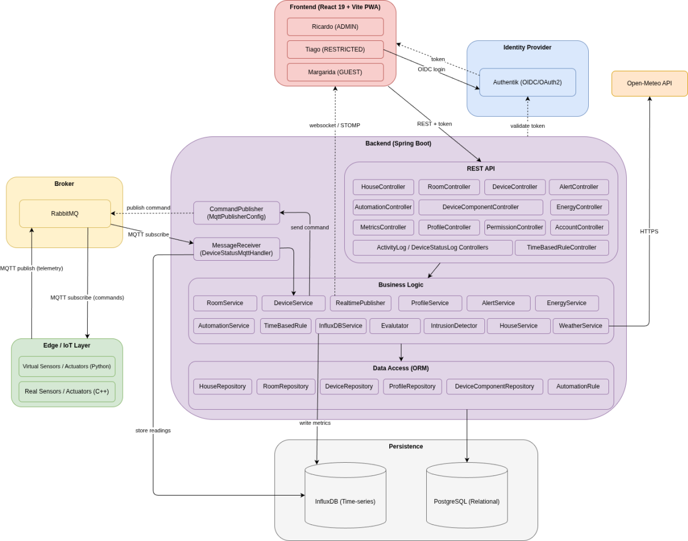

# Smart Home Dashboard
**IES 25/26 - G403**

## Descrição do Projeto

O **Smart Home Dashboard** é uma plataforma web integrada concebida para auxiliar os utilizadores na monitorização, automação e gestão de ambientes domésticos em tempo real. A aplicação recolhe e processa continuamente dados vitais da habitação — incluindo temperatura interior, deteção de movimento, estado da iluminação e consumos energéticos.

Através de fluxos de dados distribuídos via **MQTT** e de uma arquitetura baseada em microsserviços, o grande objetivo é criar uma casa segura, confortável e eficiente. O sistema destaca-se por oferecer uma interface adaptável, suportada por um rigoroso Controlo de Acessos Baseado em Perfis (RBAC), tornando-se intuitivo tanto para administradores *tech-savvy* como para utilizadores seniores ou dependentes.

## Equipa

| Nome | Papel |
| :--- | :--- |
| **Rodrigo Simões** | Team Manager |
| **Pedro Gonçalves** | Product Owner |
| **Dinis Sousa** | Architect |
| **Simão Pinto** | DevOps Master |

*Nota: Todos os membros da equipa acumulam o papel de Developer e contribuem para as tarefas de desenvolvimento.*

## Bookmarks / Acesso Rápido

* [Quadro de Tarefas no GitHub (Scrum Board)](https://github.com/orgs/detiuaveiro/projects/248)
* [Atas de Reunião (/minutes)](./minutes)
* [Relatórios de Especificação (/reports)](./reports)
* [Documentação da API REST](./reports/ApiDocumentation.pdf)

## Arquitetura do Sistema

O diagrama abaixo reflete a infraestrutura atualizada planeada para contentorização, demonstrando o fluxo de telemetria, atuação e persistência.

